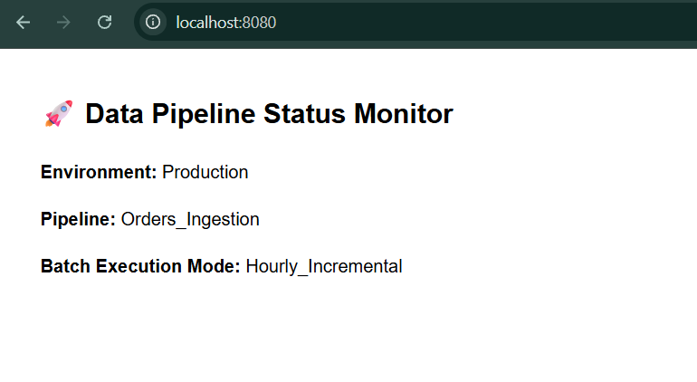

# Data Pipeline Status Monitor (Docker Containerization)

A hands-on implementation demonstrating core Docker concepts in the context of Data Engineering, including custom image building, layered caching, environment configuration, port forwarding, and the interaction between `ENTRYPOINT` and `CMD`.

---

## Output Preview



---

## Core Concepts Implemented

1. **Custom Image Construction:** Built a lightweight Python runtime container using `python:3.11-slim`.
2. **Environment Isolation & Injection:** Extracted configurations (`APP_ENV`, `PIPELINE_NAME`) to runtime environment variables using the `-e` flag.
3. **Port Binding (Networking):** Mapped host port `8080` to internal container port `8080` (`-p 8080:8080`) to serve metrics via standard HTTP requests.
4. **ENTRYPOINT vs CMD:** 
   - Configured `ENTRYPOINT` as the fixed process executable (`python server.py`).
   - Configured `CMD` as the default argument (`Hourly_Incremental`), easily overridable via CLI arguments.
5. **Container Lifecycle Management:** Handled background execution (`-d`), dynamic inspection (`docker inspect`), and ephemeral execution (`--rm`).

---

## Project Structure

```text
├── Dockerfile        # Container build instructions
├── server.py         # HTTP status server (Standard Library)
├── output.png        # Screenshot of the live service
└── README.md         # Documentation
```

---

## Reproduction Steps

### 1. Build the Docker Image
```bash
docker build -t pipeline-monitor:v1 .
```

### 2. Run with Custom Environment Variables
Run in detached mode, exposing port 8080:
```bash
docker run -d -p 8080:8080 --name my_pipeline_service \
  -e APP_ENV=Production \
  -e PIPELINE_NAME=Orders_Ingestion \
  pipeline-monitor:v1
```

Access the service via browser at:
`http://localhost:8080`

### 3. Verify Container State & Logs
```bash
# View active containers
docker ps

# Stream logs
docker logs my_pipeline_service

# Inspect injected environment variables
docker inspect my_pipeline_service
```

### 4. Override CMD at Runtime
Clean up the existing container and run with an overridden batch mode:
```bash
docker stop my_pipeline_service
docker rm my_pipeline_service

# Overriding default CMD ("Hourly_Incremental") with "Realtime_Streaming"
docker run -d -p 8080:8080 --name my_pipeline_service --rm \
  pipeline-monitor:v1 Realtime_Streaming
```
